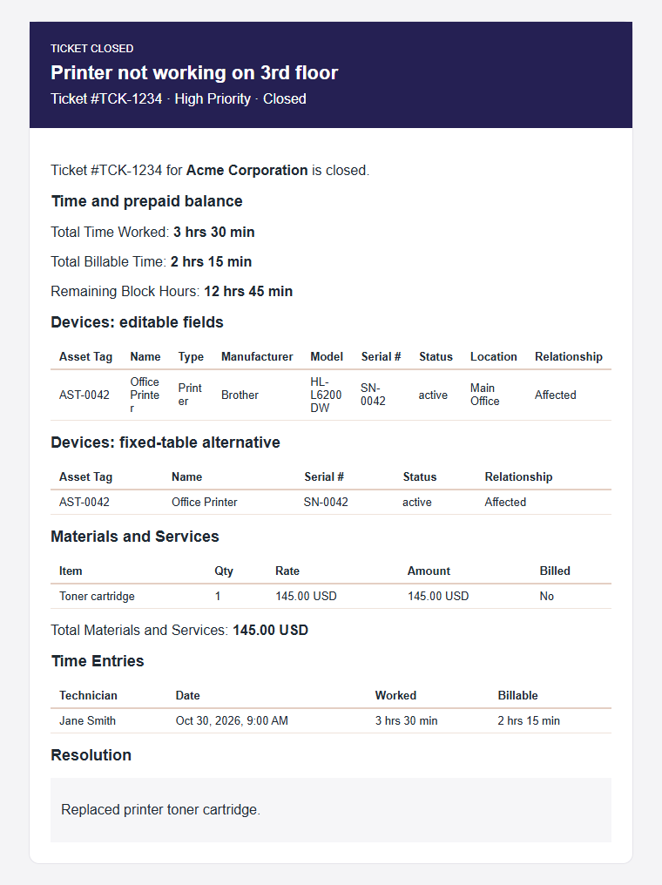
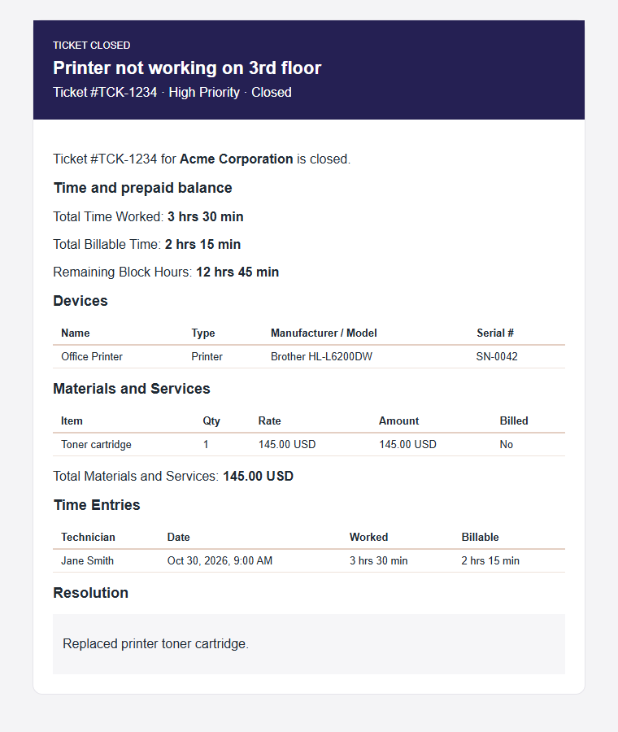

# Editing ticket email HTML

Open **Settings > Notifications > Email Templates**, customize the
**Ticket Closed** template, and edit its HTML and plain-text versions.
The **Variables** panel lists the variables available to that particular
template. Its examples and the preview use sample data, not a customer's ticket.
Save only after checking both versions and sending a test email.

The fields below are available for `ticket-closed`, in both client and internal
emails. They are not automatically available in other ticket notification types.
Existing templates do not change until you add the variables to their markup.

## Fields added for ticket details

| Variable | Content |
| --- | --- |
| `ticket.assets` | Editable list of linked assets; use `{{#each ticket.assets}}`. |
| `ticket.assetsHtml` | Fixed HTML table: asset tag, name, serial number, status, relationship. |
| `ticket.materialsHtml` | Fixed HTML table: material/service, quantity, rate, amount, billed state. |
| `ticket.materialsTotal` | Formatted total of the material/service line amounts. |
| `ticket.timeHtml` | Fixed HTML table: technician, date, worked time, billable time. |
| `ticket.totalTimeWorked` | Total time recorded as worked on this ticket. |
| `ticket.totalTimeBillable` | Total recorded billable time, including time not yet invoiced. |
| `ticket.remainingBlockHours` | Client's available prepaid block hours when the email is generated. |

Remaining block hours include usage already deducted before invoicing. They
are a client balance, not just this ticket's usage, and may differ between the
preview sample and an actual send. A ticket without a client reports `0 hrs`.
Money and dates in the detail tables follow the email's resolved locale, with
dates using its resolved timezone.

### Editable asset fields

Inside `{{#each ticket.assets}}`, use any of the following. All fields are
optional **in your markup**: omit the field to omit it from the email.

| Field | Example | Meaning |
| --- | --- | --- |
| `{{assetTag}}` | AST-0042 | Asset tag; you can omit it independently of the name. |
| `{{name}}` | Office Printer | Asset name. |
| `{{assetType}}` | Printer | Tenant's type display name, or stored slug if no registry entry exists. |
| `{{manufacturer}}` | Brother | Manufacturer. |
| `{{model}}` | HL-L6200DW | Model. |
| `{{serialNumber}}` | SN-0042 | Serial number. |
| `{{status}}` | active | Stored asset status. |
| `{{location}}` | Main Office | Asset location. |
| `{{relationship}}` | Affected | Affected or Related ticket relationship. |

Missing asset values are empty strings. No linked assets means an empty list.
The Variables panel inserts a complete editable loop for `ticket.assets`.
Individual field insertions use `{{this.name}}`, for example; insert those
**inside** the loop. `{{name}}` and `{{this.name}}` are equivalent there.

Use **double braces** for individual values so user-entered content is escaped.
Use **triple braces** only for the pre-rendered blocks, such as
`{{{ticket.materialsHtml}}}`. Triple braces around an array do not produce a
customizable asset table.

## Complete example: all added fields

This example shows all nine editable asset fields, the fixed asset table
alternative, material/service details and total, time entries, worked and
billable totals, and remaining block hours. Showing both asset layouts is for
documentation only; normally choose one. The stock template is not replaced.

All detail tables below use the fixed renderer's exact inline styles: font,
cell padding, border colors, alignment, and wrapping are identical. Only the
selected columns differ. The full nine-column asset example may be wide in a
narrow email pane; use the selected-column version when fewer fields suffice.



```html
<!DOCTYPE html>
<html lang="en">
<head>
  <meta charset="utf-8">
  <meta name="viewport" content="width=device-width,initial-scale=1">
  <title>Ticket closed</title>
</head>
<body style="margin:0;padding:24px;background:#f4f4f6;font-family:Arial,sans-serif;color:#1f2933;">
  <table role="presentation" cellpadding="0" cellspacing="0" style="width:100%;max-width:680px;margin:0 auto;background:#ffffff;border:1px solid #e5e4ea;border-radius:12px;">
    <tr>
      <td style="padding:24px;background:#252053;color:#ffffff;">
        <div style="font-size:12px;text-transform:uppercase;">Ticket Closed</div>
        <h1 style="margin:8px 0;font-size:22px;">{{ticket.title}}</h1>
        <div>{{ticket.metaLine}}</div>
      </td>
    </tr>
    <tr>
      <td style="padding:24px;">
        <p>Ticket #{{ticket.id}} for <strong>{{ticket.clientName}}</strong> is closed.</p>
        <h2 style="font-size:18px;">Time and prepaid balance</h2>
        <p>Total Time Worked: <strong>{{ticket.totalTimeWorked}}</strong></p>
        <p>Total Billable Time: <strong>{{ticket.totalTimeBillable}}</strong></p>
        <p>Remaining Block Hours: <strong>{{ticket.remainingBlockHours}}</strong></p>

        {{#if ticket.assets}}
        <h2 style="font-size:18px;">Devices: editable fields</h2>
        <table style="border-collapse:collapse;width:100%;margin:0;font-size:13px;">
          <thead>
            <tr>
              <th style="text-align:left;padding:6px 10px;border-bottom:2px solid rgba(146,64,14,0.25);font-weight:600;color:#1f2933;white-space:nowrap;">Asset Tag</th>
              <th style="text-align:left;padding:6px 10px;border-bottom:2px solid rgba(146,64,14,0.25);font-weight:600;color:#1f2933;white-space:nowrap;">Name</th>
              <th style="text-align:left;padding:6px 10px;border-bottom:2px solid rgba(146,64,14,0.25);font-weight:600;color:#1f2933;white-space:nowrap;">Type</th>
              <th style="text-align:left;padding:6px 10px;border-bottom:2px solid rgba(146,64,14,0.25);font-weight:600;color:#1f2933;white-space:nowrap;">Manufacturer</th>
              <th style="text-align:left;padding:6px 10px;border-bottom:2px solid rgba(146,64,14,0.25);font-weight:600;color:#1f2933;white-space:nowrap;">Model</th>
              <th style="text-align:left;padding:6px 10px;border-bottom:2px solid rgba(146,64,14,0.25);font-weight:600;color:#1f2933;white-space:nowrap;">Serial #</th>
              <th style="text-align:left;padding:6px 10px;border-bottom:2px solid rgba(146,64,14,0.25);font-weight:600;color:#1f2933;white-space:nowrap;">Status</th>
              <th style="text-align:left;padding:6px 10px;border-bottom:2px solid rgba(146,64,14,0.25);font-weight:600;color:#1f2933;white-space:nowrap;">Location</th>
              <th style="text-align:left;padding:6px 10px;border-bottom:2px solid rgba(146,64,14,0.25);font-weight:600;color:#1f2933;white-space:nowrap;">Relationship</th>
            </tr>
          </thead>
          <tbody>
            {{#each ticket.assets}}
            <tr>
              <td style="padding:6px 10px;border-bottom:1px solid rgba(146,64,14,0.15);color:#1f2933;word-break:break-word;">{{assetTag}}</td>
              <td style="padding:6px 10px;border-bottom:1px solid rgba(146,64,14,0.15);color:#1f2933;word-break:break-word;">{{name}}</td>
              <td style="padding:6px 10px;border-bottom:1px solid rgba(146,64,14,0.15);color:#1f2933;word-break:break-word;">{{assetType}}</td>
              <td style="padding:6px 10px;border-bottom:1px solid rgba(146,64,14,0.15);color:#1f2933;word-break:break-word;">{{manufacturer}}</td>
              <td style="padding:6px 10px;border-bottom:1px solid rgba(146,64,14,0.15);color:#1f2933;word-break:break-word;">{{model}}</td>
              <td style="padding:6px 10px;border-bottom:1px solid rgba(146,64,14,0.15);color:#1f2933;word-break:break-word;">{{serialNumber}}</td>
              <td style="padding:6px 10px;border-bottom:1px solid rgba(146,64,14,0.15);color:#1f2933;word-break:break-word;">{{status}}</td>
              <td style="padding:6px 10px;border-bottom:1px solid rgba(146,64,14,0.15);color:#1f2933;word-break:break-word;">{{location}}</td>
              <td style="padding:6px 10px;border-bottom:1px solid rgba(146,64,14,0.15);color:#1f2933;word-break:break-word;">{{relationship}}</td>
            </tr>
            {{/each}}
          </tbody>
        </table>
        {{/if}}

        {{#if ticket.assetsHtml}}
        <h2 style="font-size:18px;">Devices: fixed-table alternative</h2>
        {{{ticket.assetsHtml}}}
        {{/if}}

        {{#if ticket.materialsHtml}}
        <h2 style="font-size:18px;">Materials and Services</h2>
        {{{ticket.materialsHtml}}}
        <p>Total Materials and Services: <strong>{{ticket.materialsTotal}}</strong></p>
        {{/if}}

        {{#if ticket.timeHtml}}
        <h2 style="font-size:18px;">Time Entries</h2>
        {{{ticket.timeHtml}}}
        {{/if}}

        <h2 style="font-size:18px;">Resolution</h2>
        <div style="padding:12px;background:#f6f6f8;">{{{ticket.resolution}}}</div>
      </td>
    </tr>
  </table>
</body>
</html>
```

## Example: omit fields from the HTML

For a shorter device section, replace the editable asset section above with
this block, and remove the fixed-table alternative. This keeps name, type,
manufacturer/model, and serial number; it deliberately omits asset tag,
status, location, and relationship.



```html
{{#if ticket.assets}}
<h2 style="font-size:18px;">Devices</h2>
<table style="border-collapse:collapse;width:100%;margin:0;font-size:13px;">
  <thead>
    <tr>
      <th style="text-align:left;padding:6px 10px;border-bottom:2px solid rgba(146,64,14,0.25);font-weight:600;color:#1f2933;white-space:nowrap;">Name</th>
      <th style="text-align:left;padding:6px 10px;border-bottom:2px solid rgba(146,64,14,0.25);font-weight:600;color:#1f2933;white-space:nowrap;">Type</th>
      <th style="text-align:left;padding:6px 10px;border-bottom:2px solid rgba(146,64,14,0.25);font-weight:600;color:#1f2933;white-space:nowrap;">Manufacturer / Model</th>
      <th style="text-align:left;padding:6px 10px;border-bottom:2px solid rgba(146,64,14,0.25);font-weight:600;color:#1f2933;white-space:nowrap;">Serial #</th>
    </tr>
  </thead>
  <tbody>
    {{#each ticket.assets}}
    <tr>
      <td style="padding:6px 10px;border-bottom:1px solid rgba(146,64,14,0.15);color:#1f2933;word-break:break-word;">{{name}}</td>
      <td style="padding:6px 10px;border-bottom:1px solid rgba(146,64,14,0.15);color:#1f2933;word-break:break-word;">{{assetType}}</td>
      <td style="padding:6px 10px;border-bottom:1px solid rgba(146,64,14,0.15);color:#1f2933;word-break:break-word;">{{manufacturer}} {{model}}</td>
      <td style="padding:6px 10px;border-bottom:1px solid rgba(146,64,14,0.15);color:#1f2933;word-break:break-word;">{{serialNumber}}</td>
    </tr>
    {{/each}}
  </tbody>
</table>
{{/if}}
```

To restore the tag, add an `Asset Tag` header cell and a corresponding
`<td>{{assetTag}}</td>` inside the row loop, using the same padding and border
styles as the other cells. To omit any column, remove both the column's `<th>`
and corresponding `<td>`; removing just the value leaves an
empty column. You cannot customize columns inside `ticket.assetsHtml` from
the template: use `ticket.assets` instead.

To omit an entire section, remove its heading, block, and wrapper. For example,
remove the complete `{{#if ticket.timeHtml}}...{{/if}}` section to hide
individual time entries while retaining the time totals. Likewise, remove
the Remaining Block Hours paragraph if that balance should not be shared.
Do not merely remove a variable while leaving its label behind.

Keep the same number of cells in every row. Do not conditionally remove a
single `<td>` when its value is missing: leave it empty or put a conditional
inside it, such as `<td>{{#if serialNumber}}{{serialNumber}}{{else}}Not recorded{{/if}}</td>`.
`{{#if ticket.assets}}` hides the section for an empty asset list.
The preview displays registry examples, not real-time account balances; verify
empty-data cases and actual delivery with a test ticket.

## Plain-text version

Keep the plain-text template consistent with the HTML. Use the same loops
without HTML tags; do not insert pre-rendered HTML blocks into plain text.

```handlebars
Total Time Worked: {{ticket.totalTimeWorked}}
Total Billable Time: {{ticket.totalTimeBillable}}
Remaining Block Hours: {{ticket.remainingBlockHours}}

{{#if ticket.assets}}
Devices:
{{#each ticket.assets}}
{{name}} - {{assetType}}
{{manufacturer}} {{model}}
{{#if serialNumber}}Serial Number: {{serialNumber}}{{/if}}
{{/each}}
{{/if}}

Materials and Services Total: {{ticket.materialsTotal}}
```

Only assets have individually selectable row fields in this addition.
`ticket.materialsHtml` and `ticket.timeHtml` remain pre-rendered tables;
include or omit each whole block, rather than trying to edit its inner columns.
For resolution content in plain text, preserve the existing template's
plain-text handling rather than inserting an HTML fragment.

## Related documentation

- [Email branding](email-branding.md)
- [Email settings access](email_settings_access.md)
- [Variable registry design and dated additions](../plans/2026-07-17-email-template-variables-plan.md)
