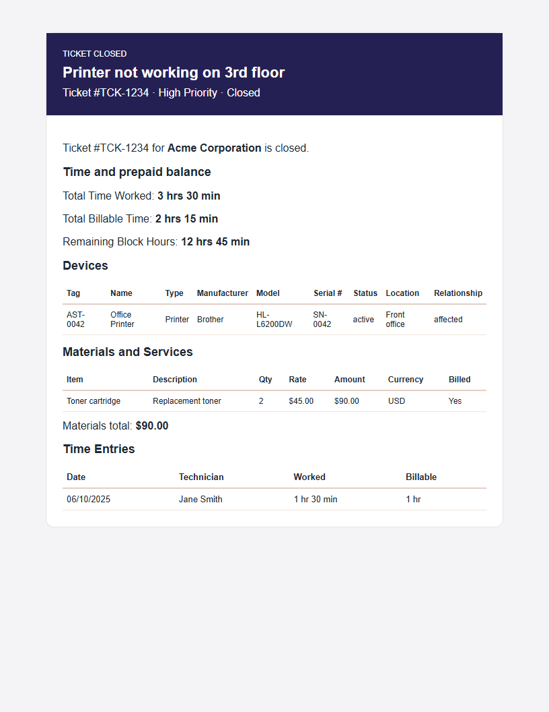
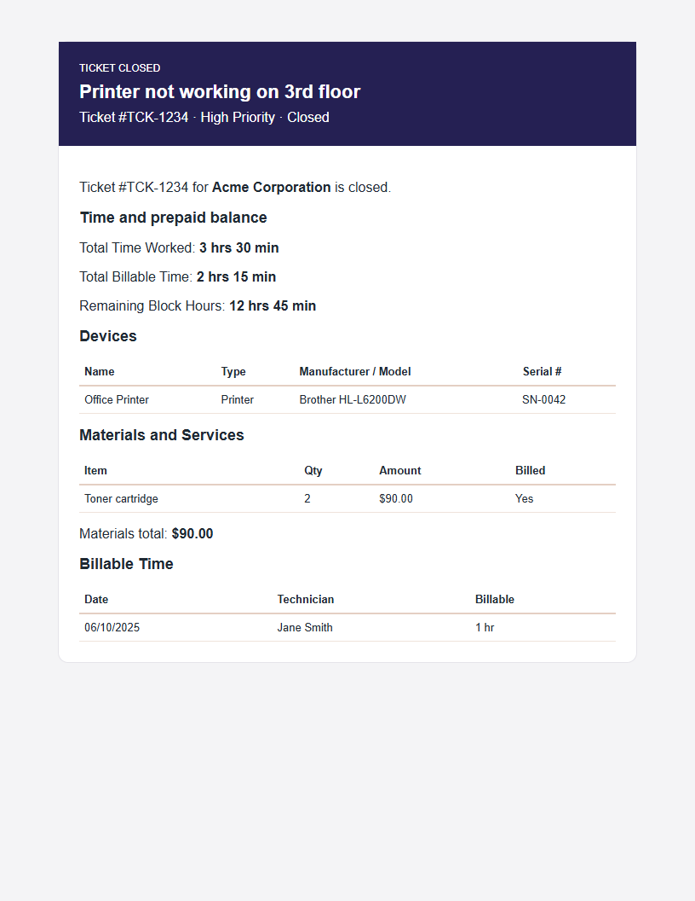

# Ticket-closed detail variables 

The existing `ticket-closed` notification exposes plain-data arrays for custom
templates. Stock templates, notification routing and existing translations are
unchanged. These variables are not added to other ticket notifications.

| Variable | Contents |
|---|---|
| `ticket.assets` | `assetTag`, `name`, `assetType`, `manufacturer`, `model`, `serialNumber`, `status`, `location`, `relationship` |
| `ticket.materials` | `name`, `description`, `quantity`, `rate`, `amount`, `currencyCode`, `billed` |
| `ticket.timeEntries` | `date`, `technician`, `worked`, `billable` |
| `ticket.materialsTotal` | Currency-formatted material totals; different currencies are listed separately, not added together |
| `ticket.totalTimeWorked` | All recorded worked time |
| `ticket.totalTimeBillable` | Recorded billable time, including uninvoiced time |
| `ticket.remainingBlockHours` | Available, unexpired prepaid hours at send time |

Empty arrays are `[]`; missing asset fields are empty strings. Material quantities
are numbers and `billed` is a boolean. Material rates and amounts use each row's
currency. Durations use the existing hours/minutes formatter. Time-entry dates
use `MM/DD/YYYY` in the email's existing effective timezone; rows are ordered by
work timestamp, technician and entry ID. Multiple entries for the same technician
remain separate. No translation lookup or HTML rendering is performed.

Each empty state is independent of the others:

- No materials: `ticket.materials` is `[]` and `ticket.materialsTotal` is an
  empty string.
- No time entries: `ticket.timeEntries` is `[]` and both
  `ticket.totalTimeWorked` and `ticket.totalTimeBillable` are `0 hrs`. A ticket
  with materials but no time still reports `0 hrs`; a ticket with time but no
  materials still reports its worked and billable time.
- No client, or no available prepaid hour block: `ticket.remainingBlockHours`
  is `0 hrs`.

If a ticket's detail data cannot be built (for example a database error or an
unsupported material currency), the email is still sent with every detail
variable for that ticket in the empty state above, and a warning is logged
with the tenant and ticket.

The three duration values are always non-empty strings, so
`{{#if ticket.totalTimeWorked}}` and similar checks are always true. Guard the
tables with their array (for example `{{#if ticket.timeEntries}}`) instead.

## Two editable HTML examples

These illustrations use the email-template preview component and its sample
data, not a customer's notification or a deployed instance. The preview shows
one example row per array; its sample totals are illustrative and need not equal
that row. Both templates use ordinary double braces to escape row values. All
labels, styling and column choices belong to the custom template, not the
variables. The illustrations use a US Letter portrait page with half-inch
margins. The preview width varies with the editor; narrow panes may wrap
columns or scroll horizontally. The colors below are example template styles,
not the tenant's applied branding. Email clients do not inherit the
application's CSS theme variables, so the examples use inline color values.

### Example 1: every added field

This includes all nine device fields, all seven material fields, all four time
fields, and the four totals/balance variables.



```html
<!DOCTYPE html>
<html lang="en">
<head>
  <meta charset="utf-8">
  <meta name="viewport" content="width=device-width,initial-scale=1">
  <title>Ticket closed</title>
</head>
<body style="margin:0;padding:48px;background:#f4f4f6;font-family:Arial,sans-serif;color:#1f2933;">
  <table role="presentation" cellpadding="0" cellspacing="0" style="width:100%;max-width:680px;margin:0 auto;background:#ffffff;border:1px solid #e5e4ea;border-radius:12px;">
    <tr>
      <td style="padding:24px;background:#252053;color:#ffffff;">
        <div style="font-size:12px;text-transform:uppercase;">Ticket Closed</div>
        <h1 style="margin:8px 0;font-size:22px;">{{ticket.title}}</h1>
        <div>{{ticket.metaLine}}</div>
      </td>
    </tr>
    <tr>
      <td style="padding:24px;">
  <p>Ticket #{{ticket.id}} for <strong>{{ticket.clientName}}</strong> is closed.</p>
  <h2 style="font-size:18px;">Time and prepaid balance</h2>
  <p>Total Time Worked: <strong>{{ticket.totalTimeWorked}}</strong></p>
  <p>Total Billable Time: <strong>{{ticket.totalTimeBillable}}</strong></p>
  <p>Remaining Block Hours: <strong>{{ticket.remainingBlockHours}}</strong></p>

  {{#if ticket.assets}}
  <h2 style="font-size:18px;">Devices</h2>
  <table style="border-collapse:collapse;width:100%;margin:0;font-size:12px;">
    <thead>
      <tr style="border-bottom:2px solid rgba(146,64,14,0.25);text-align:left;">
        <th style="padding:8px 6px;">Tag</th>
        <th style="padding:8px 6px;">Name</th>
        <th style="padding:8px 6px;">Type</th>
        <th style="padding:8px 6px;">Manufacturer</th>
        <th style="padding:8px 6px;">Model</th>
        <th style="padding:8px 6px;">Serial #</th>
        <th style="padding:8px 6px;">Status</th>
        <th style="padding:8px 6px;">Location</th>
        <th style="padding:8px 6px;">Relationship</th>
      </tr>
    </thead>
    <tbody>
      {{#each ticket.assets}}
      <tr style="border-bottom:1px solid rgba(146,64,14,0.15);">
        <td style="padding:8px 6px;">{{assetTag}}</td>
        <td style="padding:8px 6px;">{{name}}</td>
        <td style="padding:8px 6px;">{{assetType}}</td>
        <td style="padding:8px 6px;">{{manufacturer}}</td>
        <td style="padding:8px 6px;">{{model}}</td>
        <td style="padding:8px 6px;">{{serialNumber}}</td>
        <td style="padding:8px 6px;">{{status}}</td>
        <td style="padding:8px 6px;">{{location}}</td>
        <td style="padding:8px 6px;">{{relationship}}</td>
      </tr>
      {{/each}}
    </tbody>
  </table>
  {{/if}}

  {{#if ticket.materials}}
  <h2 style="font-size:18px;">Materials and Services</h2>
  <table style="border-collapse:collapse;width:100%;margin:0;font-size:12px;">
    <thead>
      <tr style="border-bottom:2px solid rgba(146,64,14,0.25);text-align:left;">
        <th style="padding:8px 6px;">Item</th>
        <th style="padding:8px 6px;">Description</th>
        <th style="padding:8px 6px;">Qty</th>
        <th style="padding:8px 6px;">Rate</th>
        <th style="padding:8px 6px;">Amount</th>
        <th style="padding:8px 6px;">Currency</th>
        <th style="padding:8px 6px;">Billed</th>
      </tr>
    </thead>
    <tbody>
      {{#each ticket.materials}}
      <tr style="border-bottom:1px solid rgba(146,64,14,0.15);">
        <td style="padding:8px 6px;">{{name}}</td>
        <td style="padding:8px 6px;">{{description}}</td>
        <td style="padding:8px 6px;">{{quantity}}</td>
        <td style="padding:8px 6px;">{{rate}}</td>
        <td style="padding:8px 6px;">{{amount}}</td>
        <td style="padding:8px 6px;">{{currencyCode}}</td>
        <td style="padding:8px 6px;">{{#if billed}}Yes{{else}}No{{/if}}</td>
      </tr>
      {{/each}}
    </tbody>
  </table>
  <p style="margin:12px 0;">Materials total: <strong>{{ticket.materialsTotal}}</strong></p>
  {{/if}}

  {{#if ticket.timeEntries}}
  <h2 style="font-size:18px;">Time Entries</h2>
  <table style="border-collapse:collapse;width:100%;margin:0;font-size:13px;">
    <thead>
      <tr style="border-bottom:2px solid rgba(146,64,14,0.25);text-align:left;">
        <th style="padding:8px 6px;">Date</th>
        <th style="padding:8px 6px;">Technician</th>
        <th style="padding:8px 6px;">Worked</th>
        <th style="padding:8px 6px;">Billable</th>
      </tr>
    </thead>
    <tbody>
      {{#each ticket.timeEntries}}
      <tr style="border-bottom:1px solid rgba(146,64,14,0.15);">
        <td style="padding:8px 6px;">{{date}}</td>
        <td style="padding:8px 6px;">{{technician}}</td>
        <td style="padding:8px 6px;">{{worked}}</td>
        <td style="padding:8px 6px;">{{billable}}</td>
      </tr>
      {{/each}}
    </tbody>
  </table>
  {{/if}}
      </td>
    </tr>
  </table>
</body>
</html>
```

### Example 2: selected device and time columns

Devices keep name, type, manufacturer/model and serial number. Materials keep
item, quantity, amount and billed state. Time entries keep date, technician and
billable time, omitting worked time from the table. Remove both a column's `<th>`
and matching `<td>` to omit a field; retain empty cells for missing values so
the remaining columns stay aligned.



```html
<!DOCTYPE html>
<html lang="en">
<head>
  <meta charset="utf-8">
  <meta name="viewport" content="width=device-width,initial-scale=1">
  <title>Ticket closed</title>
</head>
<body style="margin:0;padding:48px;background:#f4f4f6;font-family:Arial,sans-serif;color:#1f2933;">
  <table role="presentation" cellpadding="0" cellspacing="0" style="width:100%;max-width:680px;margin:0 auto;background:#ffffff;border:1px solid #e5e4ea;border-radius:12px;">
    <tr>
      <td style="padding:24px;background:#252053;color:#ffffff;">
        <div style="font-size:12px;text-transform:uppercase;">Ticket Closed</div>
        <h1 style="margin:8px 0;font-size:22px;">{{ticket.title}}</h1>
        <div>{{ticket.metaLine}}</div>
      </td>
    </tr>
    <tr>
      <td style="padding:24px;">
  <p>Ticket #{{ticket.id}} for <strong>{{ticket.clientName}}</strong> is closed.</p>
  <h2 style="font-size:18px;">Time and prepaid balance</h2>
  <p>Total Time Worked: <strong>{{ticket.totalTimeWorked}}</strong></p>
  <p>Total Billable Time: <strong>{{ticket.totalTimeBillable}}</strong></p>
  <p>Remaining Block Hours: <strong>{{ticket.remainingBlockHours}}</strong></p>

  {{#if ticket.assets}}
  <h2 style="font-size:18px;">Devices</h2>
  <table style="border-collapse:collapse;width:100%;margin:0;font-size:13px;">
    <thead>
      <tr style="border-bottom:2px solid rgba(146,64,14,0.25);text-align:left;">
        <th style="padding:8px 6px;">Name</th>
        <th style="padding:8px 6px;">Type</th>
        <th style="padding:8px 6px;">Manufacturer / Model</th>
        <th style="padding:8px 6px;">Serial #</th>
      </tr>
    </thead>
    <tbody>
      {{#each ticket.assets}}
      <tr style="border-bottom:1px solid rgba(146,64,14,0.15);">
        <td style="padding:8px 6px;">{{name}}</td>
        <td style="padding:8px 6px;">{{assetType}}</td>
        <td style="padding:8px 6px;">{{manufacturer}} {{model}}</td>
        <td style="padding:8px 6px;">{{serialNumber}}</td>
      </tr>
      {{/each}}
    </tbody>
  </table>
  {{/if}}

  {{#if ticket.materials}}
  <h2 style="font-size:18px;">Materials and Services</h2>
  <table style="border-collapse:collapse;width:100%;margin:0;font-size:13px;">
    <thead>
      <tr style="border-bottom:2px solid rgba(146,64,14,0.25);text-align:left;">
        <th style="padding:8px 6px;">Item</th>
        <th style="padding:8px 6px;">Qty</th>
        <th style="padding:8px 6px;">Amount</th>
        <th style="padding:8px 6px;">Billed</th>
      </tr>
    </thead>
    <tbody>
      {{#each ticket.materials}}
      <tr style="border-bottom:1px solid rgba(146,64,14,0.15);">
        <td style="padding:8px 6px;">{{name}}</td>
        <td style="padding:8px 6px;">{{quantity}}</td>
        <td style="padding:8px 6px;">{{amount}}</td>
        <td style="padding:8px 6px;">{{#if billed}}Yes{{else}}No{{/if}}</td>
      </tr>
      {{/each}}
    </tbody>
  </table>
  <p>Materials total: <strong>{{ticket.materialsTotal}}</strong></p>
  {{/if}}

  {{#if ticket.timeEntries}}
  <h2 style="font-size:18px;">Billable Time</h2>
  <table style="border-collapse:collapse;width:100%;margin:0;font-size:13px;">
    <thead>
      <tr style="border-bottom:2px solid rgba(146,64,14,0.25);text-align:left;">
        <th style="padding:8px 6px;">Date</th>
        <th style="padding:8px 6px;">Technician</th>
        <th style="padding:8px 6px;">Billable</th>
      </tr>
    </thead>
    <tbody>
      {{#each ticket.timeEntries}}
      <tr style="border-bottom:1px solid rgba(146,64,14,0.15);">
        <td style="padding:8px 6px;">{{date}}</td>
        <td style="padding:8px 6px;">{{technician}}</td>
        <td style="padding:8px 6px;">{{billable}}</td>
      </tr>
      {{/each}}
    </tbody>
  </table>
  {{/if}}
      </td>
    </tr>
  </table>
</body>
</html>
```

## Plain-text content

Closed-ticket notifications do not send the template's Text Content field. The
plain-text alternative of every closed-ticket email is generated from the
rendered HTML body: tags are removed, common entities such as `&amp;` and
`&lt;` are decoded back to their characters, and all whitespace, including line
breaks, is collapsed to single spaces. The HTML body is therefore the only
place to lay out these variables; text written in the Text Content field is
saved with the template but not used for these emails.

Because line breaks are collapsed, put visible separators (labels, punctuation
or table headers) in the HTML so the generated text stays readable, for
example `<td>{{date}}</td>` cells under a `Date` header rather than relying on
cell layout alone.

## Variables panel

Individual field tokens are loop-local; for example, `{{name}}` or
`{{this.name}}` belongs inside the device loop. In the editor's Variables
panel, selecting an array inserts an editable loop at the cursor; its example
shows the shape of one array row.
