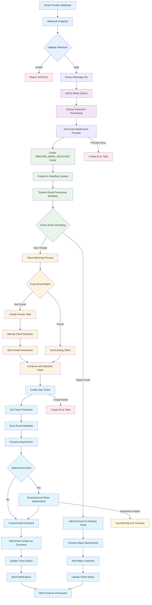

# Email-to-Ticket Workflow Architecture

This document contains the canonical flow diagram for converting an inbound email into a Ticket through the workflow engine.  All other docs should reference this file instead of embedding their own copy.

## Mermaid Diagram

### Notes

* The workflow file in code is `workflows/system-email-processing.json`.
* Human task generation points are highlighted in yellow.

## Forwarded client email

When a technician forwards a client's email to the helpdesk mailbox, the ticket is created under the original sender's contact and client. The technician stays the internal author of the first comment.

* **Internal users only.** Only a forward from an authenticated internal user is honoured. A forward from a contact or an unknown sender is handled like any other message, and the forwarder stays the contact.
* **Existing contact required.** The original sender must match a contact in the tenant. If there is no match, if the address belongs to an internal user, or if the forward names more than one possible sender, the ticket is created exactly as it would be without this feature.
* **Inbound rules win.** If an inbound email rule assigns a client, that client is used.
* **Existing threads are unchanged.** A forward into an existing ticket thread keeps that ticket's client.

The original sender is read from a forwarded `message/rfc822` attachment, or from the first forward header block in the plain-text body (Outlook, Gmail, Apple Mail, including German and French labels). HTML-only forwards are not attributed. Set `INBOUND_RESOLVE_FORWARDED_SENDER=false` to turn the feature off.

## Workflow events published

When the system email processing workflow creates a new ticket (node **T** in the diagram), it stamps an `occurredAt` timestamp and publishes a `TICKET_CREATED` event to the workflow event bus. Any custom workflow in the Automation Hub that is attached to the **Ticket Created** trigger will therefore fire for inbound-email tickets, just as it does for tickets created through the UI, API, or client portal.

If a matching workflow trigger is skipped — for example, because a payload field is missing, a schema reference is unrecognised, or a parameter mapping fails — the event row's `error_message` column is updated with a human-readable diagnostic. Query `workflow_events` where `error_message IS NOT NULL` to investigate silent non-fires.
